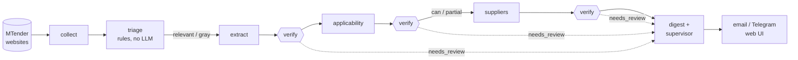

# Tender Engine — LLM-powered public tender analysis

A self-hosted engine that collects public tenders every day, reads their documents, and tells a
system integrator **which tenders it can actually win and at what margin**. Built for the Moldovan
market (MTender + procurement websites), with Claude models doing the reading and reasoning and
plain code doing everything that must be exact.


-orange)

---

## What it does

1. **Collects** tenders from MTender (OCDS JSON API) and from arbitrary procurement websites
   (generic web collector, optional Crawl4AI rendering), incrementally and with cross-source dedup.
2. **Triages** them without an LLM: weighted CPV codes and keywords put each tender into
   `relevant` / `gray` / `out`. Nothing is deleted — `out` keeps its reason.
3. **Reads the documents**: PDF (PyMuPDF) and DOCX (python-docx); scanned PDFs go through
   vision-model OCR. Boilerplate sections of the standard procurement template are cut locally
   to save tokens.
4. **Extracts the specification**: subject, technical requirements, equipment list, deadlines,
   qualification criteria, estimated value.
5. **Checks applicability** against the company profile: `can` / `partial` / `cannot`, a readiness
   score, what matched, and what is missing.
6. **Matches suppliers** from the catalog; the **code** (not the LLM) computes cost, currency
   conversion and margin, and flags a margin as partial when items or FX rates are missing.
7. **Supervises**: a daily digest ranks the best opportunities, borderline cases are escalated to a
   stronger model, and collection coverage is monitored (stalled source, sudden drop in volume).
8. **Notifies** by email / Telegram and shows everything in a web UI (inbox, browse, planning,
   tender detail, settings) for admin and company users.

## Pipeline



## Design decisions

- **Worker ↔ verifier.** Every analytical LLM stage is paired with a cheaper verifier model that
  checks the result against the source documents (missing fields, invented facts, numbers). On
  failure the worker retries with the verifier's hint; if it still fails, the tender is flagged
  `needs_review` instead of silently passing.
- **"The LLM judges, the code counts."** Models decide whether a product matches a spec; prices,
  quantities, FX conversion and margin are computed in code.
- **Model per stage.** Haiku for extraction/verification and the gray zone, Sonnet for applicability
  of relevant tenders, Opus only for escalations — all configurable.
- **Config as data.** Pipelines, schedule, sources, weights, prompts and model choice live in SQLite
  as versioned config with history, rollback and hot reload. The core engine knows nothing about
  tenders: it runs stages from config, so the tender monitor is just the first configuration.
- **Honest failure.** If a model's JSON cannot be parsed, the raw answer is stored and the tender
  goes to review; a missing API key is reported loudly instead of falling back to the stub silently.
- **Cost control.** Response cache by hash, token/cost accounting per stage, document cache,
  escalation budget.

## Tech stack

Python 3.10 · FastAPI · SQLite (WAL) · Anthropic Claude API · PyMuPDF · python-docx ·
Crawl4AI (optional) · systemd · 72 pytest test modules.

## Project structure

```
app.py               CLI entry point (collect, triage, extract, applicability, suppliers, digest, web, ...)
engine/              Domain-agnostic core: stage registry, orchestrator, scheduler, config store,
                     DB layer, LLM gateway, document reading, health checks, accounts
workflows/           Tender-specific stages: collectors, triage, extract, verify, applicability,
                     suppliers, supervisor, notify
web/                 FastAPI web UI (admin zone + company user zone)
config/defaults/     Seed configuration (applied only for keys that do not exist yet)
deploy/              systemd units (system and user level)
tools/               config_cli.py (get/set/history/rollback), view.py (read-only inspection)
tests/               Test suite
docs/DEVLOG.ru.md    Phase-by-phase development log and operating notes (Russian)
```

## Quick start

```bash
git clone https://github.com/Madly222/mcp4tender.git tenderengine && cd tenderengine
python3 -m venv .venv && .venv/bin/pip install -r requirements.txt
echo 'ANTHROPIC_API_KEY=sk-ant-...' > .env        # without a key the LLM provider is a free stub

.venv/bin/python app.py check                     # DB, schema, configs, stages
.venv/bin/python app.py user add --login admin --role admin
.venv/bin/python app.py web                       # web UI
.venv/bin/python app.py serve                     # scheduler daemon (or use deploy/*.service)
```

Run stages by hand:

```bash
.venv/bin/python app.py collect mtender
.venv/bin/python app.py triage
.venv/bin/python app.py extract --limit 1
.venv/bin/python app.py applicability --limit 1
.venv/bin/python app.py suppliers --limit 1
.venv/bin/python app.py supervise                 # escalations + coverage + digest
```

Configuration (examples):

```bash
python3 tools/config_cli.py list
python3 tools/config_cli.py set capabilities.profile '{"company": "...", "vendor_partnerships": {...}}'
python3 tools/config_cli.py set suppliers.fx_rates '{"EUR->MDL": 19.6}'
python3 tools/config_cli.py history llm.models
```

The company profile and supplier catalog shipped in `config/defaults/` are **examples**; replace
them with your own via the web settings page or `config_cli.py`.

## Tests

```bash
.venv/bin/pip install pytest httpx
.venv/bin/python -m pytest tests -q
```

## More

The full development log — phases 0–7, operating commands and design notes — is in
[docs/DEVLOG.ru.md](docs/DEVLOG.ru.md) (Russian).
